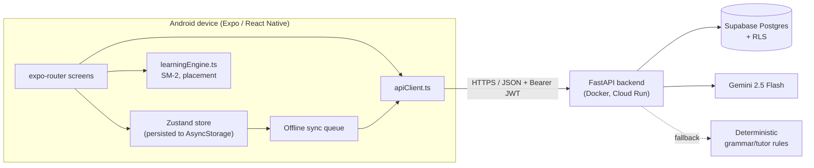

# Architecture — FluentUp (as built)

This file describes what **actually runs today**. The target design (Supabase Auth, SecureStore, idempotent XP, ER diagram, RLS) is in [`docs/ARCHITECTURE.md`](docs/ARCHITECTURE.md). Where the two differ, this file is the truth about current behavior and [`FIX_PROMPT.md`](FIX_PROMPT.md) lists how to close the gap.

## System overview

## Mobile (`apps/mobile`)

- **Routing:** expo-router. `app/(tabs)/` holds Home (`index`), Learn, Practice, Progress and Profile. Stack screens: `onboarding`, `auth`, `lesson/[id]`, `legal`.
- **State:** one Zustand store (`src/store/useAppStore.ts`) persisted to AsyncStorage. It holds profile, level, XP, streaks, lesson progress, mistakes, flashcard state, the offline sync queue **and the auth token** (plaintext; see FIX_PROMPT #7).
- **Content:** bundled seed data in `src/data/curriculum.ts` and `src/data/practiceCatalog.ts`. Lessons work fully offline.
- **Learning logic:** `src/services/learningEngine.ts` runs SM-2 scheduling and placement scoring on the device.
- **Network:** `src/services/apiClient.ts` wraps fetch. The base URL comes from `EXPO_PUBLIC_API_URL` and falls back to `http://10.0.2.2:8000` (emulator host) even in production builds (FIX_PROMPT #10).
- **Validation:** Zod schemas in `src/schemas/domain.ts`.

### Offline sync flow

1. Progress events (lesson completion, quiz attempts, vocab reviews) are pushed onto the queue in the store.
2. When online, `apiClient` posts the queue to `POST /sync/batch`.
3. On a 2xx response the client clears the whole queue.

**Current bug:** the backend returns `synced: true` without writing anything, so queued progress is lost (FIX_PROMPT #3). Logout also clears the queue (FIX_PROMPT #8).

## Backend (`apps/backend`)

- **FastAPI** app in `app/main.py`, settings from env in `app/config.py`, JWT and rate limiting in `app/security.py`, Pydantic schemas in `app/schemas.py`, SQLAlchemy 2 models in `app/models.py`.
- **Schema:** Alembic migrations in `alembic/`, but `main.py` also calls `Base.metadata.create_all` at import (FIX_PROMPT #14). Supabase SQL migrations and RLS policies live in `supabase/migrations`.
- **Rate limits and token revocation** are in-process dictionaries. They reset on restart and don't work across multiple Cloud Run instances (FIX_PROMPT #11).

### Auth today

- Local email + password: `POST /auth/register` and `POST /auth/login` issue an HS256 JWT signed with `SUPABASE_JWT_SECRET`.
- **The password is neither stored nor checked** (FIX_PROMPT #1), and the secret has a hardcoded fallback (#2).
- An invalid bearer token is treated as anonymous instead of 401 (#5).
- Target: Supabase Auth only, backend verifies Supabase JWTs with `aud="authenticated"`.

### AI

`app/services/ai_service.py` calls Gemini 2.5 Flash via httpx and asks for JSON. On error, timeout or missing key it answers with deterministic rules (`deterministic_grammar_check`, rule-based tutor feedback). The API key is currently sent as a `?key=` query parameter (#12). Quota is skipped for anonymous callers (#5).

### Account deletion

In-app (Profile → Delete account) and a web portal for Play policy. The mobile client currently reports success even when the server call fails (#6).

## Deploy

| Part | How |
|---|---|
| Backend | `apps/backend/Dockerfile`: `python:3.13-slim`, code in `/srv/app`, `ENVIRONMENT=production`, non-root `appuser`, `HEALTHCHECK` on `/health`, uvicorn on port 8000. Target host: Google Cloud Run. |
| Database | Supabase (managed Postgres). |
| Android | EAS Build (`apps/mobile/eas.json`), package `com.fluentup.app`, target SDK 36. A `preview` profile builds a standalone APK. |

## CI (`.github/workflows/ci.yml`)

Runs on push and pull request to `main`:

- **Backend:** Python 3.13, install `requirements.txt`, `ENVIRONMENT=test PYTHONPATH=. pytest tests -v`.
- **Mobile:** Node 22, `npm ci`, typecheck, Jest.
