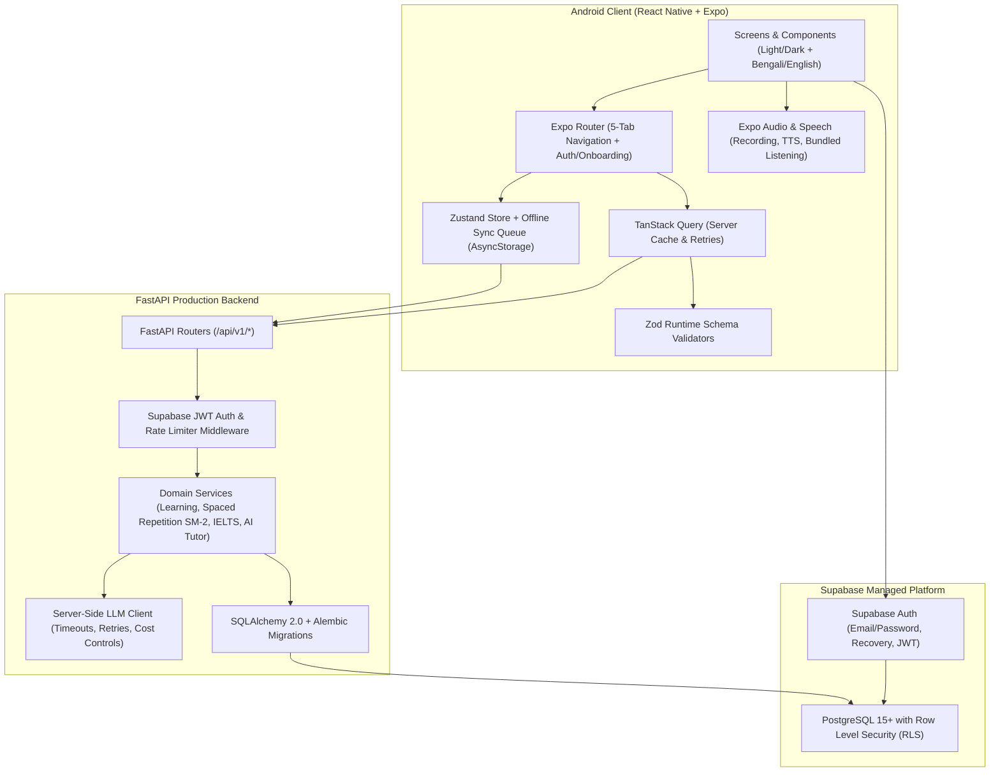

# FluentUp — Architecture & Database Design

## 1. System Architecture Overview

FluentUp is built as a maintainable monorepo containing:
- **`apps/mobile`**: Production Android application built with React Native, Expo SDK 52+, TypeScript (strict mode), Expo Router, TanStack Query v5, Zustand (with persistent local storage & offline sync queue), Zod runtime schema validation, Expo Speech / Audio modules, and Jest + React Native Testing Library.
- **`apps/backend`**: Production Python FastAPI service with Pydantic v2 validation, SQLAlchemy 2.0 ORM, Alembic database migrations, Supabase Auth JWT verification, server-side LLM integration (Google Gemini / OpenAI compatible with strict output validation, rate limiting, timeouts, and graceful fallback), and Pytest suite.
- **`supabase/migrations`**: Canonical PostgreSQL DDL and Supabase Row Level Security (RLS) policies ensuring strict per-user data isolation.
- **`docs/` & `store-assets/`**: Public legal/privacy pages, account deletion portal, Google Play store listing assets, graphics, and operational runbooks.

---

## 2. Navigation Architecture

1. **Onboarding & Placement Flow (`/(onboarding)`)**:
   - Collects preferred explanation language (`bn` Bengali + English vs `en` English-first), current proficiency, learning goal, daily study target (minutes), and learning interests.
   - Interactive Placement Assessment that scores grammar, vocabulary, and comprehension to recommend the user's starting level (`beginner`, `elementary`, `intermediate`, `upper_intermediate`, `advanced`, or `ielts`).
2. **Authentication Flow (`/(auth)`)**:
   - Login, Registration, Password Recovery, Guest Mode continuation, Privacy Policy & Terms links.
3. **Main Bottom-Tab Navigation (`/(tabs)`)**:
   - **Home (`/(tabs)/index`)**: Daily streak, XP progress, recommended next lesson, due SM-2 vocabulary reviews, offline sync badge, quick access to AI Tutor, Grammar Checker, and IELTS modules.
   - **Learn (`/(tabs)/learn`)**: Structured CEFR levels (Beginner → Advanced + IELTS), lesson prerequisites, lesson viewer (objectives, bilingual explanations, examples), interactive multi-type exercises (MCQ, sentence ordering, fill-in-the-blank, sentence construction, vocabulary recall, grammar), mistake review, and resume learning.
   - **Practice (`/(tabs)/practice`)**:
     - AI English Tutor (contextual scenarios: daily life, university, travel, job interviews, presentations, technical discussions + structured post-turn/post-conversation feedback).
     - Speaking Lab (permission-gated recording, speech transcription/editable transcript, TTS replay, offline fallback).
     - Listening Studio (bundled real WAV audio lessons, speed controls, transcript toggle, comprehension quizzes).
     - Grammar Checker (sentence/paragraph correction, structured mistake breakdown, natural rewrite, generated practice item).
     - IELTS Preparation Hub (Speaking Parts 1/2/3 with cue cards & timers, Reading passages, Listening exercises, Writing Task 1 & Task 2 with unofficial band criteria feedback).
   - **Progress (`/(tabs)/progress`)**: Weekly study minutes, XP breakdown, completed lessons, accuracy trends, mistake bank, IELTS practice history, and achievements.
   - **Profile (`/(tabs)/profile`)**: Account status (Authenticated or Guest), sync trigger, explanation language toggle (Bengali/English), theme toggle (Light/Dark/System), daily target editor, Privacy Policy & Terms viewer, Data Retention disclosure, and **In-App Account Deletion Flow**.

---

## 3. Normalized PostgreSQL Database Schema (ER Diagram)

```mermaid
erDiagram
    PROFILES ||--o{ LESSON_PROGRESS : tracks
    PROFILES ||--o{ QUIZ_ATTEMPTS : submits
    PROFILES ||--o{ USER_VOCABULARY : saves
    PROFILES ||--o{ SPEAKING_SESSIONS : records
    PROFILES ||--o{ GRAMMAR_CHECKS : runs
    PROFILES ||--o{ DAILY_ACTIVITY : logs
    PROFILES ||--o{ USER_ACHIEVEMENTS : unlocks
    PROFILES ||--o{ ACCOUNT_DELETION_REQUESTS : requests
    PROFILES ||--o{ IELTS_ATTEMPTS : completes
    LEARNING_PATHS ||--|{ LESSONS : contains
    LESSONS ||--o{ LESSON_PROGRESS : has
    LESSONS ||--o{ QUIZ_ATTEMPTS : evaluates

    PROFILES {
        uuid id PK "Matches auth.users.id"
        string email UK
        string display_name
        string explanation_language "bn | en"
        string proficiency_level "beginner..ielts"
        string learning_goal
        int daily_target_minutes
        jsonb interests
        int total_xp
        int current_streak
        int longest_streak
        date last_active_date
        string subscription_tier "free | premium"
        timestamp created_at
        timestamp updated_at
    }

    LEARNING_PATHS {
        string id PK
        string level "beginner..ielts"
        string title_en
        string title_bn
        string description_en
        string description_bn
        int display_order
        int content_version
    }

    LESSONS {
        string id PK
        string path_id FK
        string prerequisite_lesson_id FK
        string title_en
        string title_bn
        int order_index
        int xp_reward
        int estimated_minutes
        jsonb objectives
        jsonb explanations
        jsonb examples
        jsonb exercises
        int content_version
    }

    LESSON_PROGRESS {
        uuid id PK
        uuid user_id FK
        string lesson_id FK
        string status "not_started | in_progress | completed"
        int best_score
        int attempts_count
        int last_exercise_index
        boolean xp_awarded
        timestamp completed_at
        timestamp updated_at
    }

    QUIZ_ATTEMPTS {
        uuid id PK
        uuid user_id FK
        string lesson_id FK
        string client_submission_id UK "Idempotency key preventing duplicate XP"
        int score_percent
        int correct_count
        int total_questions
        int xp_earned
        jsonb mistakes
        timestamp created_at
    }

    USER_VOCABULARY {
        uuid id PK
        uuid user_id FK
        string word_or_phrase
        string meaning_bn
        string definition_en
        string example_sentence
        string phonetic
        boolean is_favorite
        int repetition_number
        float easiness_factor
        int interval_days
        timestamp next_review_at
        timestamp last_reviewed_at
        jsonb review_history
    }

    SPEAKING_SESSIONS {
        uuid id PK
        uuid user_id FK
        string scenario_id
        string mode "ai_tutor | speaking_prompt | ielts_speaking"
        text user_transcript
        jsonb structured_feedback
        int duration_seconds
        timestamp created_at
    }

    GRAMMAR_CHECKS {
        uuid id PK
        uuid user_id FK
        text original_text
        text corrected_text
        text natural_rewrite
        jsonb explanations
        jsonb practice_exercise
        timestamp created_at
    }

    IELTS_ATTEMPTS {
        uuid id PK
        uuid user_id FK
        string module_type "speaking | writing | reading | listening"
        string task_id
        text user_response
        jsonb evaluation
        float estimated_band
        timestamp created_at
    }

    DAILY_ACTIVITY {
        uuid id PK
        uuid user_id FK
        date activity_date
        int xp_earned
        int minutes_studied
        int lessons_completed
        int reviews_completed
    }

    USER_ACHIEVEMENTS {
        uuid id PK
        uuid user_id FK
        string achievement_code
        timestamp unlocked_at
    }

    ACCOUNT_DELETION_REQUESTS {
        uuid id PK
        uuid user_id
        string email
        string status "completed | pending_verification"
        string reason
        timestamp requested_at
        timestamp processed_at
    }
```

---

## 4. Production Deployment & Cost Architecture

| Component | Recommended Production Service | Free / Starter Tier Limits | Estimated Monthly Production Cost |
| :--- | :--- | :--- | :--- |
| **Database & Auth** | **Supabase** (Managed PostgreSQL + GoTrue Auth + RLS) | Free: 500 MB DB, 50,000 MAUs | **\$0/mo** (Free) → **\$25/mo** (Pro tier with daily backups & PITR) |
| **FastAPI Backend** | **Render / Railway / Google Cloud Run** (Dockerized FastAPI over HTTPS) | Cloud Run: 2M requests/mo free tier | **\$0–\$15/mo** for 1–2 instances with auto-scaling |
| **LLM Provider** | **Google Gemini 2.5 Flash API** (Server-side only) | Rate-limited free tier or pay-as-you-go | **~\$5–\$25/mo** per 1,000 active learners (enforced by server-side daily quota of 30 turns/day/free user) |
| **Android Builds** | **EAS Build / Local Gradle Release AAB** | EAS Free: 30 builds/mo; Local Gradle: Unlimited | **\$0/mo** |
| **Google Play Store** | **Google Play Console** | One-time registration fee | **\$25 one-time** |

---

## 5. Data Retention, Offline Persistence, and Security Guarantees

- **Row Level Security (RLS)**: Enabled on all user tables (`profiles`, `lesson_progress`, `quiz_attempts`, `user_vocabulary`, `speaking_sessions`, `grammar_checks`, `ielts_attempts`, `daily_activity`, `user_achievements`). Policies enforce `auth.uid() = user_id`.
- **Idempotent Progress & XP**: Every quiz/lesson completion includes a `client_submission_id` UUID and checks `lesson_progress.xp_awarded` inside a database transaction so network retries or concurrent requests never award duplicate XP.
- **Offline Storage Lifecycle**: Cached curriculum, local progress, SM-2 vocabulary cards, and queued sync mutations are stored in encrypted/sandboxed app storage (`AsyncStorage` / `Expo SecureStore` for auth tokens). Logging out or deleting the account immediately purges all local keys.
- **Account Deletion**: Deletes the user's profile and cascades across all personal learning records (`ON DELETE CASCADE`), revokes active sessions, and logs an anonymized compliance audit timestamp.
